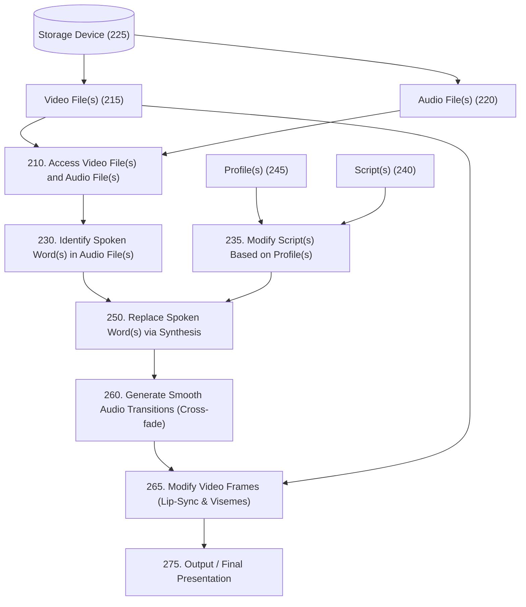

# AI Video & Audio Post-Production Enhancer

[](LICENSE)
[](https://www.python.org/)
[](#legal-disclaimer)

> **LEGAL & ACADEMIC DISCLAIMER**  
> This repository is an **independent, clean-room educational proof-of-concept (PoC)** developed strictly for research, algorithmic study, and educational experimentation.  
> It is **NOT** affiliated with, endorsed by, or sponsored by Microsoft Corporation.  
> All references to patent literature (specifically **US Patent Application No. 2026/0341309 A1**) and technical trademarks belong exclusively to their respective owners. No proprietary or reverse-engineered code from Microsoft is included.

---

## 📖 Overview
This project provides a clean-room modular implementation of the post-production speech substitution and lip-sync enhancement pipeline outlined in public patent literature (**US 2026/0341309 A1 - Fig. 2**).

It enables:
* **Identification of spoken words** across temporal timestamps (ASR alignment).
* **Audience profile adaptation** (`CHILD_SAFE`, `BRAND_COMPLIANCE`, `LOCALIZATION`).
* **Harmonic formant voice synthesis** matching the target speaker's duration.
* **Equal-Power Acoustic Crossfade** ($w_{\text{out}}^2 + w_{\text{in}}^2 = 1$) to eliminate pops, clicks, and phase distortion at splice boundaries.
* **Facial Viseme & Lip-Sync generation** for frame-by-frame mouth and jaw animation.

---

## 🏛 Patent Architecture Mapping (Fig. 2)



| Patent Block | Module Name | Implementation Source | Description |
|---|---|---|---|
| **210** | `MediaLoader` | `src/media_loader.py` | Native PCM 16-bit WAV I/O and sample extraction |
| **230** | `SpokenWordDetector` | `src/asr_detector.py` | Word parsing and millisecond timestamp alignment |
| **235** | `ScriptModifier` | `src/script_modifier.py` | Rules registry across `CHILD_SAFE`, `BRAND_COMPLIANCE`, `LOCALIZATION` |
| **250** | `FormantVocalSynthesizer` | `src/audio_synthesizer.py` | Additive harmonic synthesis with Spanish vowel formants |
| **260** | `AcousticCrossfader` | `src/audio_transitions.py` | Equal-power and sigmoid crossfading algorithms |
| **265** | `VideoLipSyncGenerator` | `src/video_lip_sync.py` | Frame-by-frame viseme and jaw displacement planner |
| **275** | `EnhancerPipeline` | `src/pipeline.py` | Master orchestrator exporting audio and metadata JSON |

---

## 🚀 Getting Started

### Prerequisites
* Python 3.10 or higher.
* Standard Python libraries (zero heavy external dependencies required for the base engine).

### Interactive Menu
Double click on `activar.bat` or run:
```bash
python run.py
```

### Command-Line Execution
```bash
# Child-safe filter (replaces profanity/violence)
python run.py --profile CHILD_SAFE --text "maldicion que gran violencia veo aqui"

# Brand compliance filter (neutralizes trademarks)
python run.py --profile BRAND_COMPLIANCE --text "estoy usando mi iphone y tomando coca-cola mientras busco en google"

# Localization filter (adapts regional slang to neutral)
python run.py --profile LOCALIZATION --text "el chaval aparco el coche y compro un ordenador guay"
```

---

## 🧪 Automated Testing (QA)
To run the full unit and integration test suite:
```bash
python tests/run_tests.py
```
**Test Coverage:**
* Mathematical energy conservation in Equal-Power Crossfade.
* Signal clamping to prevent 16-bit audio clipping.
* Formant synthesis duration accuracy.
* Multi-profile semantic rule execution.
* Full End-to-End pipeline execution.

---

## 📄 License
This project is licensed under the [MIT License](LICENSE).
